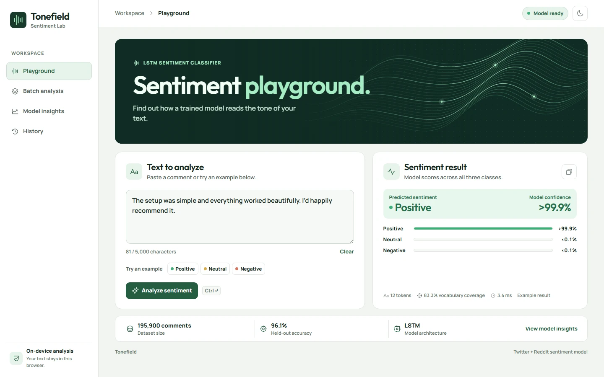

<p align="center">
  
</p>

<h1 align="center">Tonefield</h1>

<p align="center">A browser-based lab for testing the sentiment of comments, reviews, and social posts.</p>

<p align="center">
  <a href="https://shadowstudios1.github.io/tonefield/"></a>
  <a href="https://github.com/ShadowStudios1/tonefield/actions/workflows/verify.yml"></a>
  <a href="#model"></a>
  <a href="#retrain-and-predict-from-the-terminal"></a>
</p>

<p align="center"><a href="https://shadowstudios1.github.io/tonefield/"><strong>Open the live app</strong></a></p>

<a href="https://shadowstudios1.github.io/tonefield/">
  
</a>

## What you can do

| View | What it does |
| --- | --- |
| **Playground** | Score one comment, compare all three sentiment scores, and see how much of the text the model recognizes. |
| **Batch analysis** | Paste lines or import CSV and TXT files. Score up to 250 comments per run, filter them by sentiment, and export the results. |
| **Model insights** | Explore training curves, the confusion matrix, and held-out results by sentiment and data source. |
| **History** | Search, reopen, export, or clear single-text predictions saved in your browser. |

A web worker runs the exported model on your device. Your input text stays in the browser. The public demo works without a login.

## Model

The LSTM classifies comments as **positive**, **neutral**, or **negative**. Training uses 195,900 distinct examples after cleaning and deduplicating the Twitter and Reddit datasets. The vocabulary comes from the training split.

| Metric | Value |
| --- | ---: |
| Held-out test accuracy | 96.1% |
| Macro F1 | 95.7% |
| Held-out test comments | 39,180 |
| Majority-class baseline | 44.2% |

The model reads up to 100 tokens of primarily English social text. These metrics measure agreement with the supplied labels. Unfamiliar language, sarcasm, and different kinds of text can change performance.

## Run locally

Clone the repository and serve the public web directory with Python.

```sh
git clone https://github.com/ShadowStudios1/tonefield.git
cd tonefield
python -m http.server 8765 --bind 127.0.0.1 --directory docs
```

Open [http://127.0.0.1:8765](http://127.0.0.1:8765). The trained model is bundled in the repository and loads automatically.

## Retrain and predict from the terminal

Use Python 3.12 with the packages in **training/requirements.txt**. Run Python inside a virtual environment for training.

```sh
python -m pip install -r training/requirements.txt
python training/train.py predict --text "The package arrived on Monday."
```

To retrain, provide the original datasets in **data/** or pass their directory with **--data**. The training inputs are kept outside the published web directory.

| File | Text column | Label column |
| --- | --- | --- |
| **Twitter_Data.csv** | **clean_text** | **category** |
| **Reddit_Data.csv** | **clean_comment** | **category** |

Labels use **1** for positive, **0** for neutral, and **-1** for negative.

```sh
python training/train.py train --data data
```

The trainer fits an LSTM, selects the checkpoint with the lowest validation loss, and exports the model and held-out metrics to **docs/model/**. Use **--device cuda** if your PyTorch installation supports CUDA.

## Repository layout and deployment

```text
docs/                Static web app, fonts, icons, and exported model
training/            Python training and prediction CLI
scripts/             Build verification
media/               README preview
.github/workflows/   Automated checks
```

GitHub Pages publishes **main /docs** to the [live site](https://shadowstudios1.github.io/tonefield/). Keep **docs/.nojekyll** in place so GitHub serves the app files directly.

Run the same preflight locally with Node.js 20 or later.

```sh
node scripts/verify.mjs
python -m py_compile training/train.py
```
